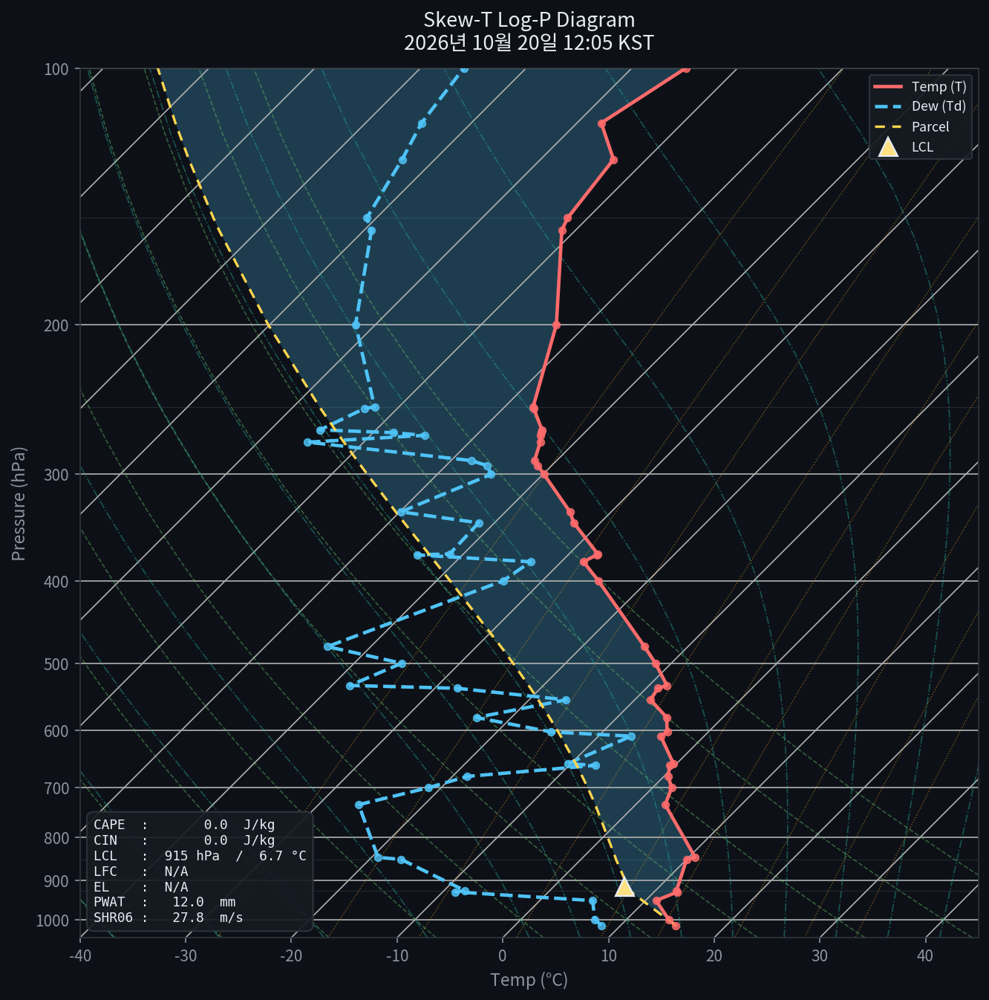
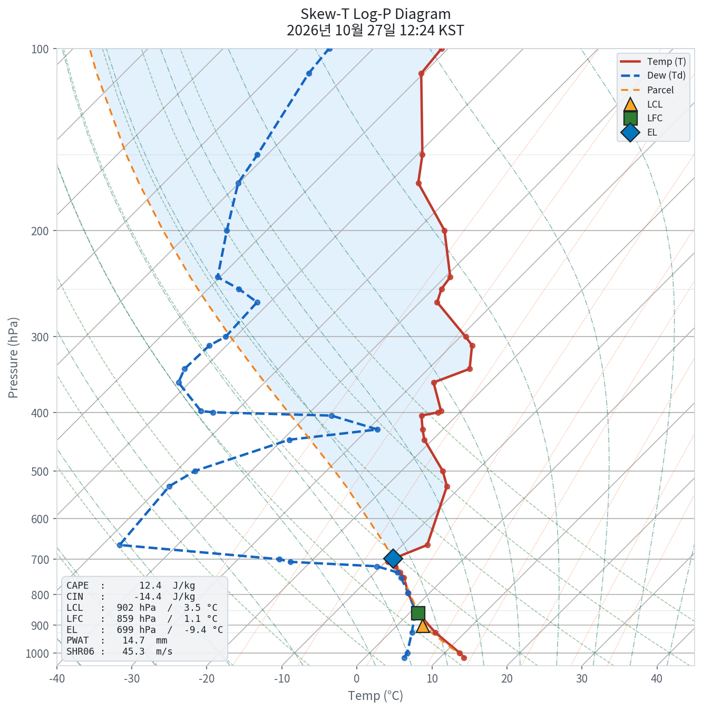

# ZONDE API Analyze

기상청 API 허브의 라디오존데 자료로 Skew-T Log-P 단열선도를 매일 그려서 올리는 프로젝트입니다.

이 레포는 테스트용입니다. 기능을 이것저것 붙였다 뗐다 하면서 다듬고, 어느 정도 완성되면 비활성화하고 원본 레포로 옮길 생각입니다.

웹페이지: https://teto-is-kawai.github.io/ZONDE-AutoUpdate-test

## 설정

1. Secret 등록
   Settings > Secrets and variables > Actions 에서 `KMA_API_URL` 을 추가합니다. 값은 기상청 API 허브에서 받은 요청 URL(인증키 포함)입니다.

2. GitHub Pages
   Settings > Pages 에서 Source를 `Deploy from a branch`, 브랜치는 `main`, 폴더는 `/docs` 로 지정합니다.

3. 실행
   매일 09:00 KST에 자동으로 돌아갑니다. 바로 돌려보려면 Actions 탭에서 Run workflow를 누르면 됩니다.

## 구성

```
.github/workflows/daily_skewt.yml   매일 실행되는 워크플로
skewt_plot.py                       자료 받기, 지수 계산, 그래프 저장
requirements.txt
docs/
  index.html                        Pages 웹페이지
  skewt_dark.png, skewt_light.png   단열선도 (자동 갱신)
  skewt_latest.png                  예전 경로 호환용 사본
  meta.json                         지수와 관측 레벨 데이터
  original.txt                      API 원본 응답
```

README 아래쪽의 `SKEWT_AUTO_START` ~ `SKEWT_AUTO_END` 사이는 스크립트가 매번 덮어씁니다.

<!-- SKEWT_AUTO_START -->
### 최신 단열선도 (2026년 10월 25일 11:52 KST)

  

| 다크 | 라이트 |
|------|--------|
|  |  |
<!-- SKEWT_AUTO_END -->

## 사용 라이브러리

- [MetPy](https://unidata.github.io/MetPy/): 단열선도, 안정도 지수 계산
- [matplotlib](https://matplotlib.org/): 그래프
- [pandas](https://pandas.pydata.org/): 데이터 처리
